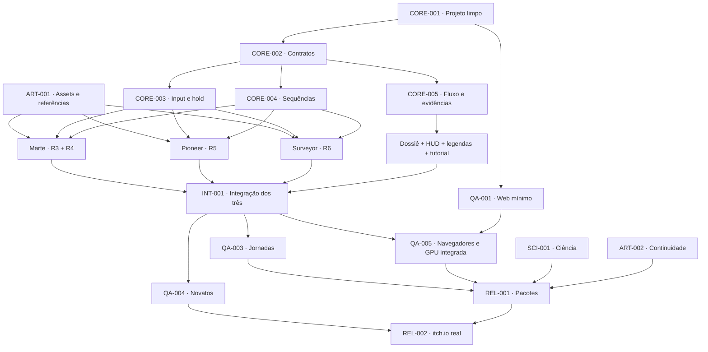

# Dependências: visão de integração

O CSV `Data/dependencies.csv` e o backlog contêm todas as 204 arestas. As relações também estão nas issues nativas do GitHub. Este diagrama resume os portões para evitar um grafo ilegível de 84 caixas.

As setas não dizem que todo trabalho de arte depende de código pronto. Referências, dados, layout e peças isoladas começam antes. O ID de cada issue informa o bloqueio exato. Não iniciar implementações contra uma API inventada apenas porque a caixa deste resumo parece liberada.
